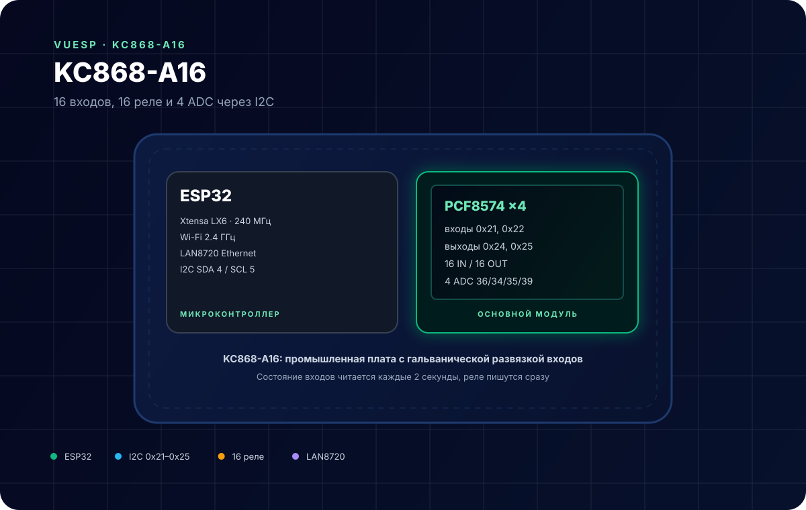
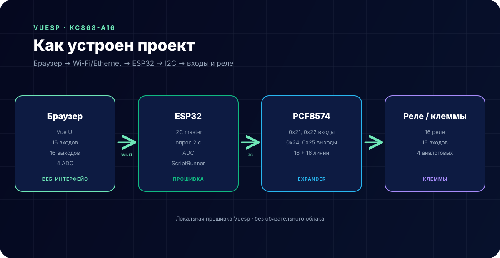

# KC868-A16 — 16 входов, 16 реле, 4 ADC



**Коротко:** `vuesp.kc868-a16` — прошивка Vuesp для промышленной платы **KinCony KC868-A16** на ESP32. 16 дискретных входов и 16 реле подключены через расширители PCF8574 по I2C, четыре аналоговых входа читаются напрямую, есть Ethernet на LAN8720.

## Что это за устройство

KC868-A16 — плата для домашней автоматизации и шкафов управления:

- ESP32 с Wi-Fi 2.4 ГГц;
- Ethernet PHY **LAN8720** (MDC 23, MDIO 18, клок GPIO17);
- 16 входов с оптопарами через два PCF8574 (`0x21`, `0x22`);
- 16 реле через два PCF8574 (`0x24`, `0x25`);
- 4 аналоговых входа (`GPIO36`, `34`, `35`, `39`);
- клеммы питания 12/24 В и выход 5 В для платы.

Прошивка читает входы каждые 2 секунды, а при изменении состояния выходов сразу пишет их в PCF8574.

## Характеристики

| Параметр | Значение |
| --- | --- |
| Микроконтроллер | ESP32 (Xtensa LX6, 240 МГц) |
| Входы | 16, оптопара, PCF8574 `0x21` / `0x22` |
| Выходы | 16 реле, PCF8574 `0x24` / `0x25` |
| ADC | 4 канала: GPIO36, 34, 35, 39 |
| I2C | SDA GPIO4, SCL GPIO5 |
| Ethernet | LAN8720, адрес 0 |
| Wi-Fi | 802.11 b/g/n, 2.4 ГГц |
| Питание платы | 12/24 В (зависит от ревизии) |
| Среда | PlatformIO + Arduino |

## Распиновка

### I2C и расширители

| Сигнал | GPIO | Адрес | Назначение |
| --- | --- | --- | --- |
| SDA | 4 | — | I2C data |
| SCL | 5 | — | I2C clock |
| IN1–IN8 | — | `0x21` | входы 1–8 |
| IN9–IN16 | — | `0x22` | входы 9–16 |
| OUT1–OUT8 | — | `0x24` | реле 1–8 |
| OUT9–OUT16 | — | `0x25` | реле 9–16 |

### Аналоговые входы

| Вход | GPIO |
| --- | --- |
| ADC1 | 36 |
| ADC2 | 34 |
| ADC3 | 35 |
| ADC4 | 39 |

### Ethernet (LAN8720)

| Сигнал | GPIO |
| --- | --- |
| MDC | 23 |
| MDIO | 18 |
| CLK | 17 (выход 50 МГц) |
| PHY address | 0 |
| POWER | не используется (`-1`) |

### Свободные GPIO

В `src/gpio/gpio.cpp` для ESP32 оставлены три свободных выхода:

| GPIO | Режим |
| --- | --- |
| 32 | `OUTPUT` |
| 33 | `OUTPUT` |
| 14 | `OUTPUT` |

## Схема подключения

Внешняя проводка — только клеммы платы:

| Клемма | Назначение |
| --- | --- |
| IN1…IN16 + COM | сухие контакты, датчики, кнопки |
| OUT1…OUT16 | нагрузки через реле (до 10 А на канал, см. паспорт) |
| AI1…AI4 | аналоговые датчики 0–3.3 В |
| 12/24 В | питание платы |
| LAN | Ethernet, если нужен проводной канал |

> **Важно.** Не подавайте 220 В на клеммы входов. Реле коммутируют нагрузку, но требуют внешнего питания и защиты; суммарный ток ограничен дорожками платы.

## Как устроен проект



- `src/device/device.cpp` — чтение PCF8574, запись реле, ADC;
- `src/gpio/gpio.cpp` — свободные GPIO и OneWire;
- `src/webserver/webserver.cpp` — HTTP, WebSocket, Ethernet;
- `src/const/struct.h` — `Device` с `portIn1/2`, `portOut1/2`, `adc1…4`;
- `vue/` — веб-интерфейс Vuesp.

Порядок работы:

```text
каждые 2 с:  PCF8574 0x21/0x22 → portIn1/portIn2 → WebSocket
изменение:   portOut1/portOut2 → PCF8574 0x24/0x25
каждые 2 с:  ADC 36/34/35/39 → adc1…adc4
```

## Веб-интерфейс

Стандартные страницы Vuesp:

- `/` — главная;
- `/dashboard/` — карточки;
- `/device/gpio/` — настройка портов;
- `/device/settings/` — Wi-Fi и авторизация;
- `/device/storage/` — LittleFS;
- `/script/` — ScriptRunner.

HTTP-обработчики: `/cmd`, `/fs`, `/update`, `/recovery`. При включённой авторизации используется HTTP Basic Auth.

## ScriptRunner

| Функция | Назначение |
| --- | --- |
| `http(method, url, count, num, data)` | заготовка HTTP-запроса |
| `$display` | строковый буфер для сценариев |

Пример работы с состояниями:

```text
log('a16 ready');
$p32=1;
```

## Сборка и прошивка

```bash
cd vue
npm ci
npm run build-web

cd ..
~/.platformio/penv/bin/pio run -e esp32
~/.platformio/penv/bin/pio run -e esp32 -t buildfs
```

Прошивка: `build/esp32/firmware.bin`, FS: `build/esp32/littlefs.bin`.

В `platformio.ini` также есть окружения `esp8266`, `pico32`, `esp32-c3-devkitm-1` — они нужны для шаблона и сборки web UI, но 16 входов/выходов через PCF8574 рассчитаны на ESP32.

## Ethernet

На ESP32 в `setupServer()` выполняется:

```cpp
ETH.begin(ETH_ADDR, ETH_POWER_PIN, ETH_MDC_PIN, ETH_MDIO_PIN, ETH_TYPE, ETH_CLK_MODE);
ETH.config(DEF_ETH_IP, DEF_ETH_GETEWAY, DEF_ETH_SUBNET, DEF_ETH_DNS);
```

Адрес по умолчанию — статический `192.168.23.135/24`, шлюз `192.168.23.1`. Wi-Fi при этом продолжает работать: плата доступна по обоим интерфейсам.

## Ограничения

- В текущем `vue/json/dashboard.json` нет готовых карточек для 16 входов и 16 реле: там остались служебные порты и демонстрационные плитки. Состояния доступны через `device.portIn1/2` и `device.portOut1/2`, но плитки нужно добавить.
- I2C-шина общая: PCF8574 и любые внешние модули должны иметь разные адреса.
- ADC у ESP32 нелинейный и шумит; для точных измерений нужна калибровка.
- Ethernet и Wi-Fi используют один радио/часовой домен: при активном Ethernet возможны конфликты питания, проверяйте блок питания.
- Реле на плате рассчитаны на определённый ток; паспорт платы важнее общего правила «10 А».
- Прошивка не управляет `DE/RE` внешнего RS485 — для Modbus нужен отдельный трансивер.

## Источники

- [KinCony KC868-A16 — описание платы](https://www.kincony.com/esp32-home-automation-board-kc868-a16.html)
- [PCF8574 datasheet](https://www.ti.com/lit/ds/symlink/pcf8574.pdf)
- [ESP32 Ethernet LAN8720](https://docs.espressif.com/projects/esp-idf/en/latest/esp32/api-reference/network/esp_eth.html)
- [Документация Vuesp](https://docs.vuesp.ru)
